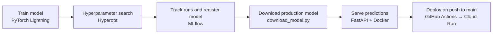

# QualityPrediction

An end-to-end machine learning pipeline that predicts the quality of white wine from its chemical properties: from training and hyperparameter search, through experiment tracking, to a containerised prediction API deployed automatically to Google Cloud Run.

## Pipeline



1. **Train** (`train.ipynb`): a small fully connected network in PyTorch Lightning, with early stopping and checkpointing.
2. **Tune**: Hyperopt's Tree-structured Parzen Estimator searches over learning rate and momentum for 15 trials.
3. **Track**: every trial is logged to MLflow (parameters, metrics and the model), and the chosen model is registered.
4. **Package**: `download_model.py` pulls the model with the `production` alias from the MLflow registry into `model_artifacts/`.
5. **Serve**: a FastAPI app loads the model and exposes a `/predict` endpoint, packaged in a Docker image.
6. **Deploy**: a GitHub Actions workflow builds the image, pushes it to Google Artifact Registry and deploys it to Cloud Run on every push to `main`.

## Data

The [Wine Quality (white)](https://archive.ics.uci.edu/dataset/186/wine+quality) dataset: 4,898 wines, 11 chemical features (acidity, residual sugar, chlorides, sulphur dioxide, density, pH, sulphates, alcohol, and so on) and a quality score from 3 to 9. The task is treated as regression.

The data is split with a fixed seed into 75% for training and validation and 25% held out as a test set. The training portion is split again 80/20 into training and validation.

## Model

| Component | Setting |
|---|---|
| Architecture | BatchNorm → Linear(11, 64) → ReLU → Dropout(0.2) → Linear(64, 32) → ReLU → Linear(32, 1) |
| Loss | Mean squared error |
| Optimiser | SGD with momentum |
| Training | Up to 15 epochs, batch size 64, early stopping on validation loss (patience 3) |
| Search space | Learning rate: log-uniform 1e-5 to 1e-1; momentum: uniform 0 to 0.9 |

## Results

The best of the 15 trials reached a **validation MSE of 0.523 (RMSE ≈ 0.72 quality points)**. For reference, the standard deviation of the quality score is 0.89, so always predicting the average would give an RMSE of about 0.89.

## Running the API

Build and run the container locally:

```bash
docker build -t quality-api .
docker run -p 8000:80 quality-api
```

Send a prediction request:

```bash
curl -X POST http://localhost:8000/predict \
  -H "Content-Type: application/json" \
  -d '{
    "fixed acidity": 7.0, "volatile acidity": 0.27, "citric acid": 0.36,
    "residual sugar": 20.7, "chlorides": 0.045, "free sulfur dioxide": 45.0,
    "total sulfur dioxide": 170.0, "density": 1.001, "pH": 3.0,
    "sulphates": 0.45, "alcohol": 8.8
  }'
```

The response is a JSON object with a single field, `predicted_quality`, holding the predicted score as a number. Interactive API documentation is available at `http://localhost:8000/docs`.

## Reproducing training

1. Start an MLflow tracking server on `http://localhost:5000`.
2. Run `train.ipynb` to launch the hyperparameter search.
3. In the MLflow UI, register the chosen model as `quality-predictor` and give it the alias `production`.
4. Run `python download_model.py` to copy it into `model_artifacts/`.

`download_model.py` reads `MLFLOW_TRACKING_URI`, `MLFLOW_MODEL_NAME` and `MLFLOW_MODEL_ALIAS` from the environment, with the defaults above.

## Project layout

```
train.ipynb            data module, model, training and hyperparameter search
download_model.py      downloads the production model from the MLflow registry
model_artifacts/       the packaged MLflow model served by the API
app/main.py            FastAPI app with the /predict endpoint
Dockerfile             container image for the API
.github/workflows/     build-and-deploy workflow for Cloud Run
```

## Tech stack

PyTorch Lightning · Hyperopt · MLflow · FastAPI · Docker · GitHub Actions · Google Cloud Run (Artifact Registry, Workload Identity Federation)

## License

MIT
